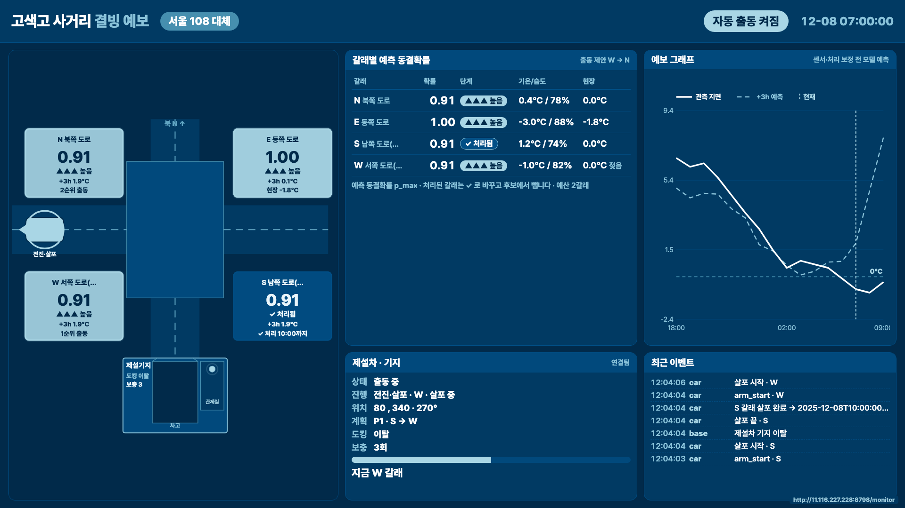
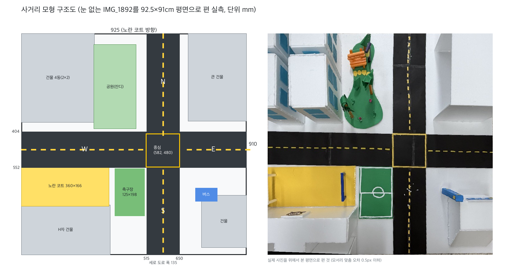

# makerton — 고색고 ICE-ZERO 자동 제설 모형

사거리 모형의 북동쪽 **제설 기지**에서 제설차가 나와 네 갈래를 **가장 빠른 순서(최적 경로)**로 밀고 돌아오는 메이커톤 작품이다. 패드로 보드를 찍으면 Claude(`claude-opus-5-5`)가 **도로 위 눈 자리를 상자로 표시**한다(표시만 하고 차는 움직이지 않는다). 출동은 '전체 청소' 버튼으로 한다. 경로는 펌웨어 경로 계획으로 모든 순서를 비교해 정한다. 사진을 규칙 기반 영상 처리로 판정해 출동하는 `/api/vision/detect`는 서버 API로 남아 있지만 패드 화면에서는 뺐다.

- 조작 화면(눈 위치 표시·전체 청소·정지): 맥 서버를 켜고 같은 핫스팟에서 `http://<맥 IP>:8000/app/`. 맥에서 `http://localhost:8000/app/`을 Chrome·Edge로 열면 'Pico 직접 조작'(USB)도 보인다.
- GitHub Pages(https://reisi09.github.io/makerton/)는 같은 화면이지만 맥 서버에 닿지 못해 안내와 지도만 보인다. 다만 '눈 위치 표시'는 그 기기에 Claude API 키를 넣으면 서버 없이 쓸 수 있다.



## 지금 상태(2026-11-01)

| 항목 | 상태 |
|---|---|
| 자동 시험 | Python 254개(`env -u ANTHROPIC_API_KEY python3 -m unittest discover -s tests`, 가상 제설차 통합 시험 포함), 웹 16개(`cd web && npm test`) 통과 |
| 출동 판단 | 패드의 '전체 청소'(`/api/sweep`) + 최적 경로(`server/route.py`). 사진 판정 출동(`/api/vision/detect`: `server/vision.py`, Claude가 켜져 있으면 `server/claude_vision.py`도)은 API로만 남았다. 날씨 예보 모델은 화면 참고용이고 출동을 정하지 않는다 |
| 조작 화면 | Next.js 정적 사이트 한 장. 맥 서버가 `/app`에서 낸다. '눈 위치 표시'(사진 → Claude 눈 상자, 표시 전용), 'Pico 직접 조작'(맥 localhost에서만), 네 갈래를 최적 순서로 도는 '전체 청소'(유일한 출동 버튼), 정지 버튼, 실측 지도 위 경로와 차의 실시간 위치(텔레메트리, 1초 갱신). 새로고침해도 마지막 판정을 서버에서 다시 받는다 |
| 눈 위치 표시 | 사진 한 장 → Claude가 눈 자리를 상자(사진 대비 0~1 비율)로 돌려주고 화면이 사진 위에 그린다. 차는 움직이지 않는다. 길이 둘이다. (가) 그 기기의 브라우저에 Claude API 키를 한 번 넣어 두었으면 화면이 Claude API를 직접 부른다(`web/lib/claudeBoxes.ts`, `@anthropic-ai/sdk`의 `dangerouslyAllowBrowser`). 키는 그 브라우저의 localStorage에만 있고 코드·저장소·서버에는 없다. 맥 서버나 같은 Wi-Fi가 없어도 되지만 화면 자체는 어딘가(맥 서버, GitHub Pages 등)에서 열려 있어야 한다. 그 브라우저를 쓰는 사람은 누구나 키를 쓸 수 있으니 여럿이 쓰는 기기에서는 '키 지우기'를 누른다. (나) 키가 없으면 `POST /api/vision/boxes`로 맥 서버를 거치며 서버에 `ANTHROPIC_API_KEY`가 있어야 한다. 브라우저가 사진을 열지 못하면(맥 Chrome의 HEIC) 원본을 맥 서버로 보내 macOS `sips`로 JPEG로 바꾸고, 서버가 돌려준 `photo`(분석한 JPEG) 위에 상자를 그린다. 서버 없이 맥 Chrome에서 HEIC를 고르면 Safari나 서버 화면을 쓰라는 오류가 뜬다. Claude는 눈 있는 갈래(`arms`)도 돌려주고, 화면은 그 갈래를 도는 가장 빠른 순서와 경로를 지도에 그린다(`web/lib/routeTable.json`, 표시만 하고 출동하지 않음). 실제 사진에서 상자·갈래 정확도는 아직 재지 않았다 |
| 사진 판정(API) | 사진 한 장 → 검은 도로 위 흰 알갱이를 갈래별로 센다 → 눈이 100mm² 이상인 갈래를 최적 순서로 출동. 판단이 애매하면(30~100mm², 비스듬한 사진, Claude와 규칙의 판단이 다름) 네 갈래를 모두 치운다. 실제 모형 사진 42장 결과는 아래 '4. 패드로 출동' |
| 제설차 Pico | 실물로 확인: 펌웨어 업로드(SHA-256 일치), 모터 방향(T3), 서버↔차 UDP 양방향(T5), 바퀴를 돌리지 않은 출동 드라이런(N 갈래 104.2초, 계산 101.8초). 2026-11-01 보드 위 시험에서 0.6ms로 바로 출발하면 떨기만 해 가감속을 넣었다. 수리로 범퍼가 반대쪽 끝으로 가서 좌우 모터 핀을 바꿨다(왼쪽 GP6~9, 오른쪽 GP2~5). Pico 2 W, MicroPython 1.29. 전원은 맥 USB, 명령은 Wi-Fi UDP. 바퀴 보정(T4·T6)은 아직 |
| 기지(센서) Pico | 코드와 시험만 있다. 눈 감지는 패드 사진이 대신할 수 있어 시연에는 선택이다 |
| 보드 실측 | 925×910mm(노란 코트 방향이 가로), 도로 폭 135, 교차로 중심 (582, 480). 아래 구조도 |
| 차 경로 | 제설 기지 = 북동쪽 건물(출입구 서쪽, N 도로). 차고 → 서쪽 182 → 남쪽 230 → 교차로 → 갈래마다 끝까지 밀고 후진 → 같은 길로 차고. 구간마다 1.2ms 간격으로 출발해 0.6ms(초당 38mm)까지 가속하고 끝에서 감속한다. 계산상 갈래 하나 약 60~73초, 네 갈래(전체 청소 S→E→W→N) 약 140초. 순서는 가감속을 넣은 시간 모형으로 고른다(스텝 수가 가장 적은 순서와 다를 수 있다). 차 길이 230, 범퍼 앞면 → 모터 바퀴 축 95(2026-11-01 실측) |
| 인쇄용 PDF | [`docs/사거리_제설차_설계도.pdf`](docs/사거리_제설차_설계도.pdf), [`docs/단순_제설차_설계도.pdf`](docs/단순_제설차_설계도.pdf), [`docs/실물부품_배선도_조립도.pdf`](docs/실물부품_배선도_조립도.pdf), [`docs/제설기지_제설차_제작가이드.pdf`](docs/제설기지_제설차_제작가이드.pdf), [`docs/라즈베리파이_시스템_설계도.pdf`](docs/라즈베리파이_시스템_설계도.pdf) |
| 글꼴 | Pretendard(`server/static/fonts/`, OFL). 웹·도면·PDF 공통 |

### 모형 구조(실측)



사진 IMG_1892의 보드 네 변을 직선으로 맞춰(오차 0.5px 이하) 92.5×91cm 평면으로 펴고 잰 값이다. 건물은 높이 때문에 지붕이 밀려 보여 위치가 ±30mm 정도다.

| 부분 | 위치(mm, 왼쪽 위가 원점) |
|---|---|
| 세로 도로(N–S) | x 515~650, 보드 위끝부터 아래끝까지 |
| 가로 도로(W–E) | y 404~552(테이프가 약 1° 기울어 오른쪽 끝은 419~552) |
| 교차로 | 노란 테두리 x 512~652, y 412~550, 중심 (582, 480) |
| 중심에서 보드 끝 | N 480, S 430, E 343, W 582 |
| 노란 코트 · 축구장 · 공원 | x 0~360 y 545~711 · x 383~508 y 554~752 · x 298~472 y 45~392 |

### 모형 갈래(임의 도로 4갈래)

| 갈래 | 이름 | 성격 | 그림자(모형) |
|---|---|---|---|
| N | 북쪽 도로 | 낮은 주택가 | 0.29 |
| E | 동쪽 도로(학교 앞) | 학교 앞, 그늘 없음 | 0.00 |
| S | 남쪽 도로 | 아파트 그늘 | 0.84 |
| W | 서쪽 도로 | 아파트 그늘(가장 깊음) | 1.00 |

모형 갈래는 **임의 도로**다. 실제 교차로를 모형에 그대로 옮기지 않았다. 갈래 이름·그림자·위험도는 `model/data/roads/cross_arms.json`에서 읽고, 코드·화면·문서에 도로명을 박지 않는다.

참고 분석: `model/icezero/roads.py`는 고색고 반경 1.5km의 OSM 도로·건물로 상대 위험도를 계산해 [`docs/img/gosaek_map.svg`](docs/img/gosaek_map.svg)에 남긴다. 이 값은 모형 갈래의 이름·근거로 쓰지 않는다.

### 날씨 예보 모델(참고용, 출동 판단에는 쓰지 않음)

수원 ASOS 119(학교에서 0.4km) 2020~2025 시간자료로 학습했다. 학습 ≤2024, 확률 보정 2024, 시험 2025다.

| 시점 | 방법 | RMSE °C | 그대로 두기(persistence) RMSE °C |
|---|---|---|---|
| +0h | 회귀 | 0.80 | 1.89 |
| +1h | 회귀·분류 혼합 | 1.26 | 1.89 |
| +3h | 회귀·분류 혼합 | 1.86 | 4.67 |
| +6h | 회귀·분류 혼합 | 2.24 | 7.01 |

- 결빙 경보(2025년 밤 118개): 결빙 밤 85개를 모두 경보했다. 결빙이 없던 밤 33개 가운데 6개는 오경보였다(18%).
- 18시에는 아직 0°C 위였다가 밤사이 얼기 시작한 27밤에서 첫 경보가 결빙보다 2시간(중앙값) 앞섰다.
- 자료는 API Hub `kma_sfctm3`로 받았고, 결측 표시 −9.0과 한 시간짜리 튐을 걸러냈다(`tools/fetch_asos.py`). 원본은 `model/data/source/119/`, 걸러낸 파일은 `model/data/raw/119/`에 있다.
- 수치 원본은 `model/models/119/metrics.json`이다. [`docs/MODEL.md`](docs/MODEL.md)에는 서울 108로 파이프라인을 검증하던 때의 설명과 지표 정의가 있다.

## 무엇이 돌아가나

- **맥북**: 서버(`0.0.0.0:8000`), Claude 눈 상자(`server/claude_vision.py`), 사진 눈 인식(`server/vision.py`), 최적 경로(`server/route.py`), 패드용 화면(`/app`), 조작 대시보드(`/`)·모니터(`/monitor`), 참고용 날씨 모델. 제설차 Pico의 전원도 맥 USB에서 받는다.
- **제설차 Pico #2(Pico 2 W, Wi-Fi UDP)**: 28BYJ-48 두 개와 병뚜껑 바퀴, 앞에 붙인 날. 북동쪽 기지 차고에서 나와 서버가 정한 순서대로 갈래를 끝까지 밀고 후진하고, 차고로 후진해 들어간다. 모터만 달았다(서보·초음파·버튼·LED·부저는 config에 핀만 있다). 서버의 정지 명령이 항상 우선하고, 서버 신호가 5초 끊기면 선다.
- **패드**: 보드를 위에서 찍어 눈 자리를 상자로 보거나(차는 안 움직임) '전체 청소'를 누른다. 출동 결과와 정지 버튼이 같은 화면에 있다.
- **기지(센서) Pico #1(USB, 선택)**: 조도·도킹 스위치. 조도센서가 덮이면 네 갈래를 최적 순서로 돌고, 도킹했을 때만 자동 출동한다.

## 폴더

```
makerton/
  CONTRACT.md          구현 계약(핀·상수·형식의 기준)
  README.md
  docs/                MODEL.md · BUILD.md · BASE_AND_CAR.md · SYSTEM_DESIGN.md · 설계도 PDF · img/
  model/icezero/       kma.py · features.py · train.py · engine.py · roads.py
  model/data/          source/119(원본) · raw/119(QC) · roads/cross_arms.json
  model/models/119/    학습 산출물(metrics.json 등)
  server/              gosaek_server.py · vision.py(사진 눈 인식) · route.py(최적 경로) · board.json(보드 실측) · static/
  pico/car/            config.py · car_core.py · main.py · hwtest.py · sweep_test.py
  pico/sensors/        config.py · sensor_core.py · main.py · hwtest.py · ssd1306.py · lcd1602.py
  tools/               pico.py(Pico 업로드) · sim_car.py(Pico 없이 펌웨어 돌리기) · fetch_asos.py·export_demo.py(날씨 모델용)
  web/                 Next.js 조작 화면(/, 예전 주소 /vision도 같은 화면) · components/BoardMap.tsx(실측 지도)
  tests/               python3 -m unittest discover -s tests
```

## 빠른 시작

### 0. 준비

맥북 Python 3.9에 pandas·numpy·scipy·Pillow·xgboost·scikit-learn·pyserial, 웹에는 Node 24가 필요하다.

```
env -u ANTHROPIC_API_KEY python3 -m unittest discover -s tests
cd web && npm ci && npm test
```

시험은 키 환경변수를 뺀 채로 돌린다(셸에 남은 키가 시험 결과를 바꾸지 않게).

### 1. 모델 학습(한 번)

```
python3 -m model.icezero.train --stn 119 --force
```

`model/models/119/`에 `reg_h*.json`, `clf_h*.json`, `calib.json`, `metrics.json`, `nights.json`이 생긴다. 기상청 자료를 다시 받을 때는 `KMA_AUTH_KEY=… python3 tools/fetch_asos.py`(키는 환경변수로만 준다).

### 2. 서버

```
python3 server/gosaek_server.py --car udp --sensors-serial none --auto
```

Claude(서버를 거치는 '눈 위치 표시'와 사진 판정의 두 번째 의견)를 쓰려면 Claude API 키를 숨김 입력으로 받아 그 셸에만 두고 서버를 켠다(zsh).

```
read -s "?Anthropic API key: " ANTHROPIC_API_KEY && echo && export ANTHROPIC_API_KEY && python3 server/gosaek_server.py --car udp --sensors-serial none --auto
```

- Claude는 `ANTHROPIC_API_KEY`가 있을 때 켜진다. 없으면 규칙만 쓰고, `/api/vision/boxes`('눈 위치 표시'의 서버 경로)는 503을 돌려준다. 서버가 시작할 때 '사진 판정:' 줄에 `규칙 + Claude(claude-opus-5-5)` 또는 `규칙 만(ANTHROPIC_API_KEY 없음)`이라고 출력한다.
- 서버 API(`/api/vision/boxes`·`/api/vision/detect`)에는 접근 키가 없다. 서버에 닿는 기기는 누구나 서버의 Claude 키로 사진을 보낼 수 있으니 같은 핫스팟에서만 켠다.
- 키 값은 파일·로그·문서에 쓰지 않는다.
- `--sensors-serial auto|PORT|none|fake`(기지 Pico와 차 Pico가 둘 다 USB에 꽂혀 있으면 기지 포트를 직접 준다), `--car udp|fake|none`, `--no-auto`, `--mode live`, `--night YYYY-MM-DD`.
- 브라우저에서 `http://localhost:8000/`(조작) 또는 `/monitor`(모니터 전용)를 연다. 서버는 시작할 때 접속 주소를 출력한다.

### 3. 제설차 Pico

```
python3 tools/pico.py put car --wifi     # Wi-Fi 이름·비밀번호는 이때 입력받아 Pico에만 쓴다
python3 tools/pico.py reset              # main.py가 돌고 서버를 찾는다
```

- 저장소의 `config.py`는 Wi-Fi 칸을 빈 문자열로 둔다. Thonny가 포트를 잡고 있으면 `실행 > 연결해제` 뒤에 쓴다.
- 배선 확인은 `hwtest.py`(모터만), 왕복 실험·바퀴 보정은 `sweep_test.py`(`MODE = "calib"` 또는 `"run"`).
- 아이폰 핫스팟은 '호환성 최대화'(2.4GHz)를 켠다. 맥이 IPv6 전용(CLAT)으로 붙으면 서버에서 차로 명령이 가지 않으니, 맥 Wi-Fi 세부사항 > TCP/IP > IPv6 구성을 '링크-로컬 전용'으로 둔다(서버가 이벤트로 경고한다).
- 차 전원은 맥 USB(마이크로 USB 케이블)에서 받는다. 보조배터리는 쓰지 않는다. 명령은 그대로 Wi-Fi UDP로 오간다.
- 기지 Pico는 `pico/sensors/`를 USB로 복사한다(Thonny 또는 같은 방식).

### 4. 패드로 출동

```
cd web && npm run build:app      # 서버가 /app 에서 내는 패드용 화면
```

- 패드를 맥과 같은 핫스팟에 붙이고 `http://<맥 IP>:8000/app/`을 연다(맥에서 열면 QR이 나온다).
- 화면은 세 부분이다.
  - **눈 위치 표시**: 사진을 찍거나 고른다. 그 기기에 Claude API 키를 한 번 넣어 두면(입력칸에 붙여 넣고 '저장', 그 브라우저의 localStorage에만 남는다) 브라우저가 Claude API를 직접 불러 맥 서버나 같은 Wi-Fi 없이도 된다. 키가 없으면 화면이 긴 변 1600px로 줄여 `POST /api/vision/boxes`로 맥 서버에 보낸다(서버에 `ANTHROPIC_API_KEY`가 없으면 503 안내). 어느 쪽이든 Claude가 돌려준 눈 상자를 사진 위에 그리고, 결과 지도에 눈 있는 갈래를 도는 최적 순서·경로·예상 시간(계산값)을 그린다. 표시만 하고 차는 움직이지 않는다. 브라우저가 사진을 열지 못하면(맥 Chrome의 HEIC) 원본을 서버로 보내 `sips`로 JPEG로 바꾸고 서버가 돌려준 사진 위에 그린다(서버가 없으면 Safari나 서버 화면을 쓰라는 오류가 뜬다). API 키가 틀리면 저장한 키를 지우고 다시 받는다. 그 브라우저를 쓰는 사람은 누구나 저장된 키를 쓸 수 있으니 여럿이 쓰는 기기에서는 '키 지우기'를 누른다. 키도 서버도 없으면(GitHub Pages 등) 이 칸의 버튼이 꺼진다.
  - **Pico 직접 조작**: 맥에서 `http://localhost:8000/app/`을 Chrome·Edge로 열었을 때만 보인다(Web Serial, Safari·아이패드는 안 됨). USB로 꽂힌 Pico의 `main.py`를 끊고 raw REPL로 작은 조작 프로그램을 올린다. 버튼이나 방향키를 누르고 있는 동안만 움직이고(300ms 동안 글자가 없으면 선다), 토크를 가장 크게 하려고 2상 풀스텝을 6.0ms 간격에서 출발해 4.0ms로 민다(초당 약 11mm). 연결을 끊으면 Pico를 다시 켜 `main.py`가 다시 돈다. 연결돼 있는 동안 화면이 5초마다 살아 있다는 글자를 보내고, 조작 프로그램은 20초 동안 아무 글자도 못 받으면 코일을 끄고 스스로 Pico를 다시 켠다. 탭을 닫거나 새로 고치면 Ctrl-C·B·D를 보낸다. 서버 경로·좌표와 무관한 수동 이동이다.
  - **전체 청소**: 화면에서 차를 출동시키는 유일한 버튼이다. 사진 없이 네 갈래를 모두 최적 순서로 돈다(`POST /api/sweep`, 출동 중이면 409). 출동 중에는 화면 위쪽 '정지' 버튼으로 멈춘다.
- 예전의 '사진 → 판정 → 바로 출동' 흐름과 '바로 출동' 스위치는 화면에서 뺐다. 서버 API `POST /api/vision/detect {"image","go"}`로는 그대로 쓸 수 있고, Claude는 서버에 `ANTHROPIC_API_KEY`가 있을 때 켜진다. 아래는 그 API의 동작과 기록이다.
- 보드 전체가 보이게 **위에서 내려다보며** 사진 한 장을 찍는다. 기준 사진·모서리 찍기는 없고, 방향은 노란 코트로 맞춘다.
- 서버는 검은 도로만 찾아 그 위 흰 알갱이를 교차로·N·S·E·W 갈래별로 센다. 노란 페인트(중앙선 점선·교차로 테두리) 위 투명 테이프의 반사, 도로 가운데 띠, 길쭉한 반사는 뺀다.
- 눈이 100mm² 이상인 갈래를 기지에서 도는 모든 순서(최대 24가지)를 비교해 가장 빠른 순서로 보낸다. 결과 화면에 순서, 예상 시간, 지도 위 경로가 나온다.
- 판단이 애매하면 네 갈래를 모두 치운다. 어느 갈래든 눈이 덮인 면적이 30mm² 이상 100mm² 미만이거나, 노란 코트가 안 보이거나, 가로·세로 도로 폭 중 큰 값이 작은 값의 1.25배를 넘으면(비스듬히 찍음) 전체 청소 순서를 적용한다.
- 실제 모형 사진 42장(2026-10-31)으로 확인했다. 눈이 있는 사진 19장에서는 모두 출동했다(전체 청소 12장, 네 갈래 경로 7장). 위에서 찍은 눈 없는 사진 5장에서는 모두 출동하지 않았다. 비스듬하게 찍혔거나 보드가 아닌 대상이 찍힌 사진 15장에서는 전체 청소를 선택했다. 낮은 각도로 찍었지만 도로 폭 검사를 통과한 1장(IMG_1885)에서는 반사를 눈으로 보고 S·N 갈래로 출동했다. 도로가 안 보이는 2장에 대해서는 다시 찍도록 안내했다.
- Claude가 켜져 있으면 규칙이 돌린 사진(노란 코트가 왼쪽 아래)을 Claude에게도 보이고 갈래별로 눈이 있는지 묻는다. 갈래별 판단이 규칙(100mm² 이상)과 하나라도 다르거나 Claude가 사진으로는 판단하기 어렵다고 하면 네 갈래를 모두 치운다. 호출이 실패하면 규칙만으로 판단한다. Claude가 생각하는 과정은 판정하는 동안 조작 화면(`/app`, 사진을 올리지 않은 기기 포함)과 모니터(`/monitor`, 예보 그래프 자리에 3분간)에 실시간으로 뜬다. 한 장에 6~10초 걸린다.
- Claude 판정은 같은 사진 42장으로 따로 확인했다(2026-11-01, 프롬프트를 한 번 쓰고 고치지 않음). 눈이 있는 사진 19장은 원본에서도, 25% 어둡게·노란 조명·살짝 흐리게 만든 사진에서도 모두 눈을 찾았다. 규칙은 같은 변형 사진에서 1~3장을 놓쳤다. 위에서 찍은 눈 없는 사진 5장 중 1장(IMG_1887)은 아래쪽이 잘렸다며 판단하기 어렵다고 했다. 갈래별 정답은 아직 없어 갈래 단위 정확도는 재지 않았다. 114회 호출에 1.81달러, 평균 6.5초였다. 이어서 서버 경로(규칙과 Claude 결합)로 42장을 다시 돌렸다. 눈 사진 19장은 모두 출동했고(최적 경로 5장, 판단이 엇갈리거나 애매해 전체 청소 14장), 위에서 찍은 눈 없는 사진은 4장이 출동하지 않고 1887만 전체 청소였다. 사고 요약은 영어로 나오고 5장은 비어 있었다. 한국어 설명은 Claude의 메모(note)로 띄운다.
- 차를 다시 만들면 `pico/car/config.py`의 `CAR_FRONT_MM`·`CAR_REAR_MM`을 재고, `BASE_X`(`BASE_XY`)·`ARM_OUT_MM`(중심→보드 끝 − 범퍼까지 − 여유 10)을 `server/board.json`과 같이 고친다. 범퍼를 반대쪽으로 옮기면 `PIN_LEFT`·`PIN_RIGHT`도 서로 바꾼다. 'Pico 직접 조작' 프로그램(`web/lib/picoJog.ts`의 `JOG_PROGRAM`)은 config를 읽지 않고 핀을 따로 적어 두었으니 같이 고친다. 펌웨어를 바꾸면 `tools/pico.py put car --wifi`로 다시 올린다.

### Pico 없이 확인하기

```
python3 tools/sim_car.py --speed 20   # 서버를 켠 맥에서. Ctrl+C로 끝낸다
```

- 실제 `pico/car/main.py`를 맥에서 돌린다. 핀·Wi-Fi·시계만 가짜이고 UDP는 진짜라서, 서버와 조작 화면에는 '제설차 연결'로 보이고 전체 청소·사진 판정 출동(API)·정지·복귀가 실물과 같은 길로 오간다.
- 코일 핀 출력에서 바퀴 회전을 거꾸로 읽어 차 위치를 따로 적분한다. 계획이 끝날 때마다 차고까지 남은 오차, 도로를 벗어난 점 수, 펌웨어 추측 위치와의 차이를 찍는다.
- 같은 검사를 `tests/test_sim_car.py`가 자동으로 한다(전체 청소 왕복, 갈래 중간 정지 뒤 복귀).
- 1배속 실시간으로 전체 청소를 끝까지 돌렸을 때(2026-10-31) 285초 동안 서버 연결이 한 번도 끊기지 않았고(텔레메트리 최대 지연 0.6초), 차고까지 오차는 0.1mm였다. 예상 254초보다 긴 것은 맥에서 돌린 시뮬레이터가 스텝 간격(1.2ms)을 정확히 지키지 못해서로 추정한다. 실물 소요 시간은 Pico에서 다시 잰다.
- 실물 Pico를 붙일 때는 가상 차를 끈다. 둘 다 켜 두면 서버가 마지막으로 패킷을 보낸 쪽에 명령을 보낸다.
- 바퀴 미끄러짐, 실제 바퀴 지름·윤거 오차, 모터 토크는 확인하지 못한다. 그건 실물 보정(T4·T6)의 몫이다.

### 5. GitHub Pages

```
cd web && npm run dev             # 로컬 미리보기
```

`main`에 `web/`나 `docs/` 변경을 푸시하면 `.github/workflows/pages.yml`이 빌드·시험·배포한다. https 페이지는 브라우저 보안 때문에 맥으로 사진을 보낼 수 없어 안내와 지도만 띄운다.

### 6. 모니터에 띄우기

```
ipconfig getifaddr en0
open -a "Google Chrome" --args --kiosk http://localhost:8000/monitor
```

같은 Wi-Fi의 다른 기기에서는 `http://<맥 IP>:8000/monitor`를 연다. 자세한 절차는 `docs/BUILD.md` 4절.

## 문서

| 문서 | 내용 |
|---|---|
| `CONTRACT.md` | 핀·상수·JSON 형식. 다른 문서와 코드가 어긋나면 이 문서를 먼저 고친다 |
| `docs/SYSTEM_DESIGN.md` | 구성, 데이터 흐름, 핀표, 전원, 프로토콜, 상태기계, 안전, 보정 |
| `docs/BASE_AND_CAR.md` | 제설기지, 제설차 제작, 도킹 보정 |
| `docs/REAL_PARTS.md` | 실물 모양 부품 도감, 배선도(선 색·핀 번호)와 조립도. 그림 생성: `docs/realparts/draw_*.py` |
| `docs/MODEL.md` | 학습 자료, 피처, 지표 정의, 방법 선택(서울 108 검증 기록) |
| `docs/BUILD.md` | 부품표, 제작 순서, 시험 T1~T12, 90초 시연 대본, 문제 해결 |

## 원칙

1. **결빙을 확정하지 않는다.** 화면·로그·발표 모두 '예측 동결확률', '상대 우선순위'라고 쓴다.
2. **자동이어도 멈출 수 있어야 한다.** 대시보드와 패드의 정지 버튼이 항상 동작한다. 서버 신호가 5초 끊기면 차가 선다(차 버튼은 달지 않았다).
3. **LLM 혼자 출동을 정하지 않는다.** 예보는 학습 모델, 출동은 코드 규칙('전체 청소', 사진 판정 API는 규칙 기반 영상 처리)이 정한다. Claude는 '눈 위치 표시'에서 눈 자리를 보여 주기만 하고, 사진 판정 API에서는 두 번째 의견이라 규칙과 다르면 전체 청소, 호출이 실패하면 규칙만 쓴다.
4. **비밀값은 저장소에 넣지 않는다.** Wi-Fi 비밀번호는 업로드할 때 입력하고, 기상청 키·서버의 Claude API 키(`ANTHROPIC_API_KEY`)는 환경변수로만 준다. 화면에서 입력하는 Claude API 키는 그 브라우저의 localStorage에만 두고 코드·저장소·서버에는 두지 않는다.
5. **센서는 보정해서 쓴다.** 시작 30초 평균 또는 `/api/sensors/baseline`으로 기준값을 잡는다.
6. **주석·UI·로그는 한국어, 식별자는 영어.**
