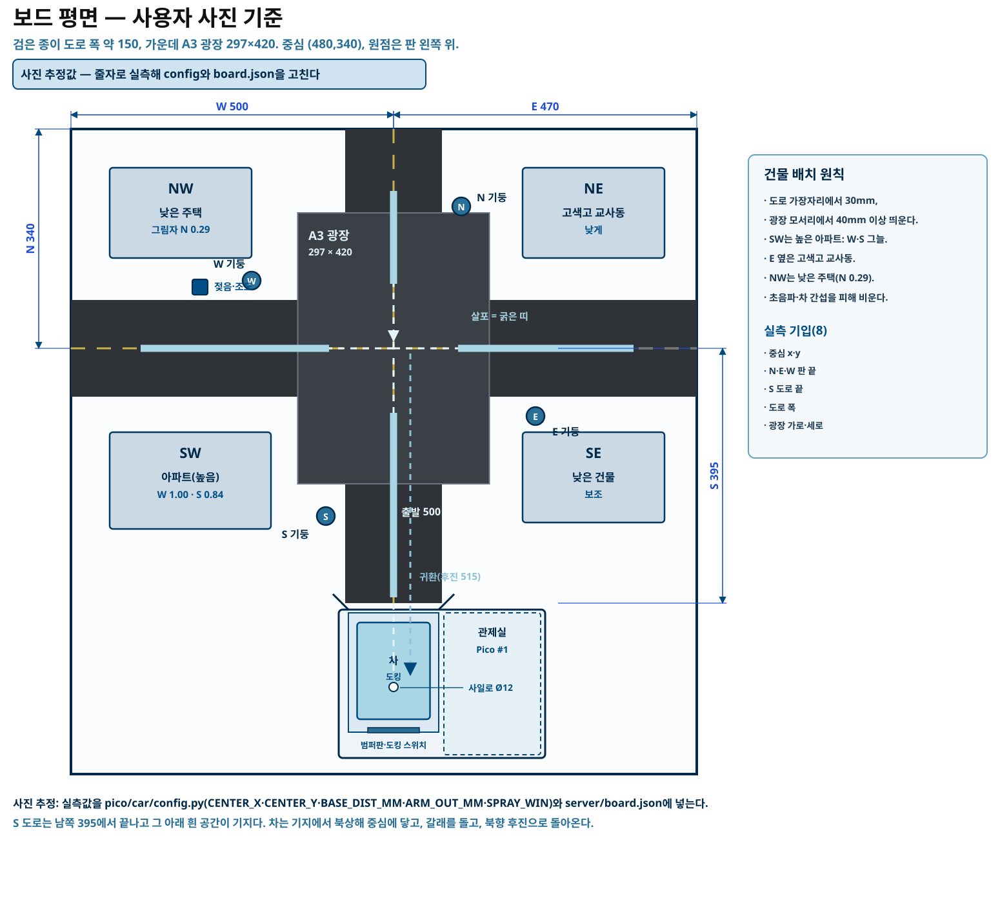
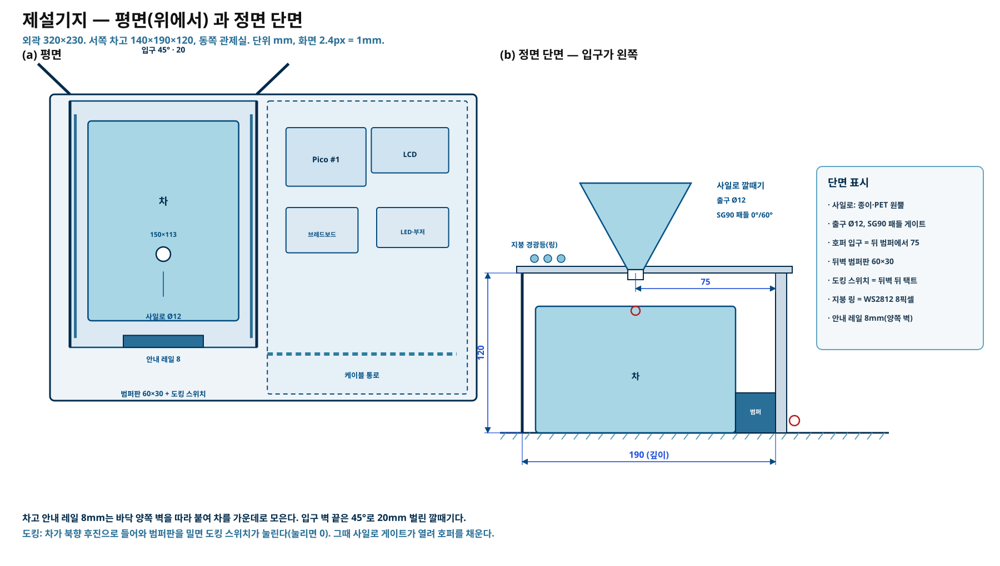

# 제설기지와 제설차 — 보드 기준 · 기지 설계 · 차 제작

사용자가 찍은 보드 사진을 기준으로 평면·기지·차를 정리한 문서다. 모든 치수는 **사진 추정값**이고, 줄자로 잰 값으로 바꿔 넣는 자리를 표로 적었다. 핀과 상수의 기준은 `CONTRACT.md` 6~9절이다.

## 1. 보드 기준(사진 추정)

- 흰 우드락 위에 검은 종이 도로를 붙였다. 도로 폭은 약 150(사진에서 잰 값).
- 가운데는 검은 A3 한 장이 광장이다. 297(동서) × 420(남북).
- N 도로는 판 위 끝까지, 가로 도로는 좌우 끝까지 간다. S 도로는 중심에서 약 395 남쪽에서 끝나고, 그 아래 흰 공간이 기지 자리다.
- 중심에서 판 끝까지: N 340 · E 470 · W 500.
- 차는 기지에서 북상해 중심에 닿고, 갈래를 돌고, 북향 **후진**으로 기지에 들어간다.

### 실측 기입표(8개)

줄자로 재서 아래 표의 오른쪽 칸에 적고, 그 값을 코드에 넣는다. 사진 추정값과 10mm 이상 다르면 그림도 고친다.

| # | 재는 값 | 사진 추정 | 넣는 곳 |
|---|---|---|---|
| 1 | 중심 x (판 왼쪽 끝 → 중심) | 480 | `pico/car/config.py` `CENTER_X`, `server/board.json` `CENTER_X` |
| 2 | 중심 y (판 위 끝 → 중심) | 340 | `CENTER_Y`, `board.json` `CENTER_Y` |
| 3 | 중심 → N 판 끝 | 340 | `board.json` `ARM_END_MM.N` |
| 4 | 중심 → E 판 끝 | 470 | `board.json` `ARM_END_MM.E` |
| 5 | 중심 → W 판 끝 | 500 | `board.json` `ARM_END_MM.W` |
| 6 | 중심 → S 도로 끝 | 395 | `board.json` `ARM_END_MM.S` |
| 7 | 도로 폭 | 150 | `board.json` `ROAD_MM` |
| 8 | 광장 가로·세로 | 297 × 420 | `board.json` `PLAZA_MM` |

추가로 두 값을 잰다.

| 값 | 사진 추정 | 넣는 곳 |
|---|---|---|
| 중심 → 기지 도킹 위치 | 500 | `BASE_DIST_MM`, `board.json` `BASE_DIST_MM` |
| 차고 뒤벽까지 밀어붙이는 여유 | 15 | `DOCK_OVERDRIVE_MM`, `board.json` `DOCK_OVERDRIVE_MM` |

차가 멈추는 거리는 판 끝에서 조금 앞이다: N·E는 90mm, W는 100mm 앞. `ARM_OUT_MM`(N 250·E 380·W 400)을 바꾸면 `SPRAY_WIN`(100부터 그 거리까지)도 같이 고친다.

## 2. 건물 배치 원칙

- 네 모퉁이(NW·NE·SW·SE) 흰 공간에만 세운다.
- **도로 가장자리에서 30mm, 광장 모서리에서 40mm 이상** 띄운다. 차 폭(113)과 초음파(8cm 정지)가 지나갈 자리를 비우는 것이다.
- SW는 가장 높은 아파트로 둔다. W·S 갈래에 그늘이 생기게 하려는 것이고, 그림자 지수 W 1.00 · S 0.84에 맞춘다.
- E 갈래 옆에는 고색고 교사동을 낮게 둔다. NW는 낮은 주택(N 0.29)이다.
- 갈래 이름과 속성은 `model/data/roads/cross_arms.json`에서 읽는다. 문서·코드에 도로명을 박지 않는다(임의 도로 4갈래).

## 3. 제설기지 설계

외곽 320(동서) × 230(남북). 서쪽에 차고, 동쪽에 관제실. 차고 입구 중심선은 S 도로 중심선과 같다.

### 3.1 치수

| 부분 | 값 | 비고 |
|---|---|---|
| 외곽 | 320 × 230 | 우드락 5mm |
| 차고 안쪽 | 폭 140 · 깊이 190 · 높이 120 | 차(113 폭)가 13mm 여유로 들어간다 |
| 입구 깔때기 | 45°, 20mm | 양쪽 벽 끝을 벌린다 |
| 안내 레일 | 높이 8mm | 바닥 양쪽 벽을 따라 |
| 범퍼판 | 60 × 30 | 뒤벽에 대고 그 뒤에 도킹 스위치 |
| 사일로 | 원뿔, 출구 Ø12 | 출구는 도킹 시 차 호퍼 입구 위(뒤 범퍼에서 75) |
| 보충 게이트 | SG90 패들, 닫힘 0° / 열림 60° | 출구 바로 아래 |

### 3.2 부품

| 부품 | 수량 | 출처 |
|---|---|---|
| 우드락 5mm | 1장(320×230 + 벽) | 추가 조달 |
| 종이컵 또는 PET 원뿔 | 1 | 사일로 |
| SG90 서보 | 1 | 키트 #11 (차와 별도 1개 더) |
| 택트 스위치 | 1 | 키트 #13 |
| 네오픽셀 WS2812 링(8픽셀) | 1 | 키트 #21 |
| I2C 1602 LCD | 1 | 키트 #3 (선택) |
| 점퍼 FF/MF | 20 | 키트 #8 |
| 핫멜트·양면테이프·절연테이프 | — | 추가 조달 |

### 3.3 재단 목록

- 바닥 320×230 ×1
- 차고 옆벽 190×120 ×2
- 차고 뒤벽 140×120 ×1
- 차고 지붕 140×190 ×1 (사일로 출구 Ø14 구멍)
- 관제실 벽 160×80 ×2, 관제실 바닥은 외곽 바닥 그대로
- 안내 레일 8×185 ×2
- 깔때기 날개 20×45 ×2 (45°로 깎기)
- 범퍼판 60×30 ×1

### 3.4 조립 순서

1. 바닥 320×230을 깐다. S 도로 중심선을 연필로 이어 그린다.
2. 차고 옆벽 2장을 세우고 안쪽 폭이 140이 되게 붙인다.
3. 뒤벽을 붙이고, 안쪽에 범퍼판(60×30)을 댄다. 범퍼판 뒤에 택트 스위치를 넣고 선을 뒤로 뺀다.
4. 안내 레일 2개를 바닥 양쪽에 붙인다(높이 8).
5. 입구 벽 끝에 45° 날개를 붙여 깔때기를 만든다.
6. 차고 지붕을 올리고, 출구 구멍 위치에 사일로 원뿔을 붙인다. 원뿔 아래에 SG90 패들을 단다.
7. 관제실 벽을 세우고 Pico #1·브레드보드·LCD·3색 LED·부저를 넣는다. 선은 바닥 밑 케이블 통로로 보낸다.
8. 지붕에 링을 붙이고 `@@SHOW`의 `beacon`으로 경광등 동작을 확인한다.

## 4. 제설차 제작

하판 100(폭)×150(길이), 바퀴를 포함한 전체 113×150, 높이 약 95.

### 4.1 부품표

| 부품 | 수량 | 키트 번호 / 조달 |
|---|---|---|
| Pico 2 WH | 1 | #1 |
| 28BYJ-48 + ULN2003 | 2조 | #10 |
| SG-90 서보 | 1 | #11 |
| SR-04 초음파 | 1 | #2 |
| 3색 LED 모듈 | 1 | #9 |
| 능동 부저 | 1 | #12 |
| 택트 스위치 | 1 | #13 |
| 점퍼 FF/MF/MM | 20 | #8 |
| USB 케이블(A to C 젠더) | 1 | #7 |
| 하판 | 우드락 2겹 또는 아크릴 100×150 | 추가 조달 |
| 바퀴 원판 | 우드락 3겹 Ø65 ×2 | 추가 조달(또는 65mm 완구 바퀴) |
| 고무줄 | 타이어용 2 | 추가 조달 |
| D축 허브 | 3×5 구멍, 또는 3D 프린트 | 추가 조달 |
| 병뚜껑 | 미끄럼 받침 2 | 추가 조달 |
| 보조배터리 5V 2A | 1 | 추가 조달 |
| 1kΩ·2kΩ 저항 | 각 1 | 추가 조달(SR-04 분압) |

### 4.2 재단

- 하판 100×150 ×2겹(접착)
- 바퀴 원판 Ø65 ×6 (3겹 × 2개)
- 호퍼 벽 50×55 ×4, 바닥 50×50 ×1 (가운데 Ø12 구멍)
- 범퍼판 60×30 ×1
- 서보 브래킷 30×20 ×1

### 4.3 조립 1~12단계

1. **하판** 100×150을 2겹으로 붙인다. 무게 중심을 뒤로 두기 위해 배터리 자리를 뒤쪽에 잡는다.
2. **모터 브래킷**: 28BYJ-48 두 개를 마주 보게, 축이 바깥으로 나가게 붙인다.
3. **바퀴 원판**: Ø65 원판 3겹을 붙여 두껍게 만든다.
4. **D축 구멍**: 원판 가운데에 3×5 구멍을 뚫어 모터 축에 맞춘다(헐거우면 글루건으로 고정).
5. **바퀴 장착**: 축에 끼우고 고무줄을 둘러 타이어로 쓴다. 두 바퀴 중심 간격을 105로 맞춘다.
6. **ULN2003 ×2**: 하판 앞쪽 좌우에 붙이고 IN1~IN4를 GP2~GP5, GP6~GP9에 연결한다.
7. **Pico·배터리**: Pico는 뒤 오른쪽, 배터리는 뒤 왼쪽. USB 포트가 뒤를 향하게 둔다.
8. **호퍼**: 가운데에 50×50×55를 붙이고, 바닥 구멍 아래에 SG90 패들을 단다.
9. **SG90 패들**: 닫힘 0°에서 구멍을 막고, 열림 70°에서 알갱이가 떨어진다.
10. **SR-04**: 앞면 가운데에 붙인다. ECHO는 1kΩ·2kΩ으로 분압한다.
11. **LED·버튼·부저·범퍼판**: LED는 뒤 오른쪽, 버튼은 뒤 왼쪽, 부저는 옆면. 범퍼판은 뒤면에 60×30.
12. **배선·보정**: `config.py`에 실측값을 넣고 5절 보정을 한다.

바퀴는 우드락 3겹 + 고무줄 타이어로 만든다. 미끄럼 받침은 병뚜껑을 앞뒤에 붙여 높이를 맞춘다.

### 4.4 배선(요약)

| 장치 | 핀 |
|---|---|
| 왼쪽 ULN2003 IN1~IN4 | GP2 · GP3 · GP4 · GP5 |
| 오른쪽 ULN2003 IN1~IN4 | GP6 · GP7 · GP8 · GP9 |
| SG90 살포 서보 | GP15 (닫힘 0°, 열림 70°) |
| SR-04 TRIG / ECHO | GP16 / GP17 |
| 택트 스위치(정지·재개) | GP14 ↔ GND (풀업) |
| 3색 LED | R GP18 · G GP19 · B GP20 |
| 부저 | GP21 |
| 전원 | 보조배터리 USB → Pico, ULN2003 VCC = VBUS, GND 공통 |

자세한 결선은 `img/car_wiring.svg`와 `SYSTEM_DESIGN.md` 4.2절을 본다.

## 5. 보정

### 5.1 1m 직진

1. 바닥에 1m 줄을 긋고 차를 북향으로 놓는다.
2. `car_core.py`의 직진 시험(또는 `plan` 없이 전진 명령)으로 1m를 간다.
3. 실제 이동 거리 `d`를 재서 `STEPS_PER_REV = 현재값 × 1000 / d`로 고친다.
4. 두 번 반복해 오차 1cm 안쪽이면 끝.

### 5.2 360° 회전

1. 바닥에 테이프로 기준선을 긋고 차를 선에 맞춘다.
2. 제자리 360° 회전시킨다.
3. 덜 돌면 `TRACK_MM`을 키우고, 더 돌면 줄인다. 좌우가 어긋나면 오른쪽 모터 보정값을 조정한다.
4. 1m 직진과 360° 회전을 번갈아 두 번 하면 자세가 맞는다.

### 5.3 도킹

1. 차를 기지 입구 200mm 앞에 북향으로 놓는다.
2. `home` 명령을 보내 후진 도킹을 시킨다.
3. 도킹 스위치가 눌리는지(`@@TEL`의 `dock`이 true) 확인한다.
4. 안 눌리면 `DOCK_OVERDRIVE_MM`을 5씩 올린다. 너무 세게 밀면 15로 되돌린다.
5. 도킹 후 사일로 출구와 호퍼 입구가 5mm 안쪽으로 맞는지 눈으로 확인한다.

## 6. 시험 순서

| 순서 | 시험 | 통과 기준 |
|---|---|---|
| T1 | 센서 Pico 시리얼 | `@@TEL`이 2초마다, `dock`·`refills` 포함 |
| T2 | DHT11 4개 | 손으로 만지면 해당 갈래 `t`가 오른다 |
| T3 | 젖음(W)·조도 | 물방울에 `wet`이 true |
| T4 | OLED·LCD·LED·부저·링 | `@@SHOW`로 갈래 색과 경광등이 바뀐다 |
| T5 | 도킹 스위치·보충 게이트 | 손으로 누르면 `dock` true, `@@REFILL`에 게이트가 열린다 |
| T6 | 차 링크 | `hello` 뒤 `tel` 500ms |
| T7 | 1m 직진 | 오차 1cm 안쪽 |
| T8 | 360° 회전 | 기준선에 5° 안쪽 |
| T9 | 갈래 경로·살포 | 회전→전진→살포→복귀, `arm_done` |
| T10 | 도킹 | `dock` true, `plan_done` |
| T11 | 자동 보충 | 도킹 1초 뒤 게이트 800ms, `refills` 증가 |
| T12 | 자동 출동 | 센서·재생으로 `plan` → 살포 → 복귀 → 보충 |

## 7. 시연 흐름

1. **기지 출동**: 재생 시각을 밤으로 넘기면 갈래 확률이 올라간다. 자동 출동이 켜져 있으면 서버가 `plan`을 보내고, 차가 기지에서 북상한다.
2. **살포**: 중심에 닿아 갈래로 돌고, 나가는 길에만 서보를 연다. 모니터에 `phase`와 `spray`가 보인다.
3. **귀환·도킹**: 마지막 갈래를 마치면 북향으로 돌아 후진해 차고에 들어간다. 범퍼판이 도킹 스위치를 누른다.
4. **자동 보충**: 도킹이 1초 유지되면 사일로 게이트가 800ms 열려 호퍼를 채운다. `refills`가 1 늘고, 같은 도킹에서는 다시 열지 않는다.
5. **마무리**: 대시보드 `stop`으로 즉시 정지·자동 끔을 보여 준다. 화면 문구는 '예측 동결확률', '상대 우선순위'다.
