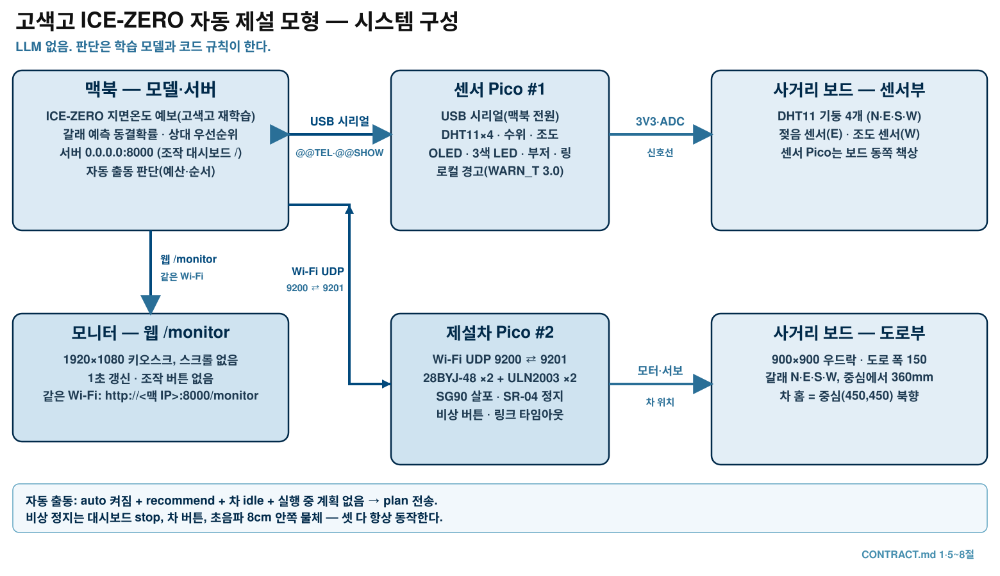
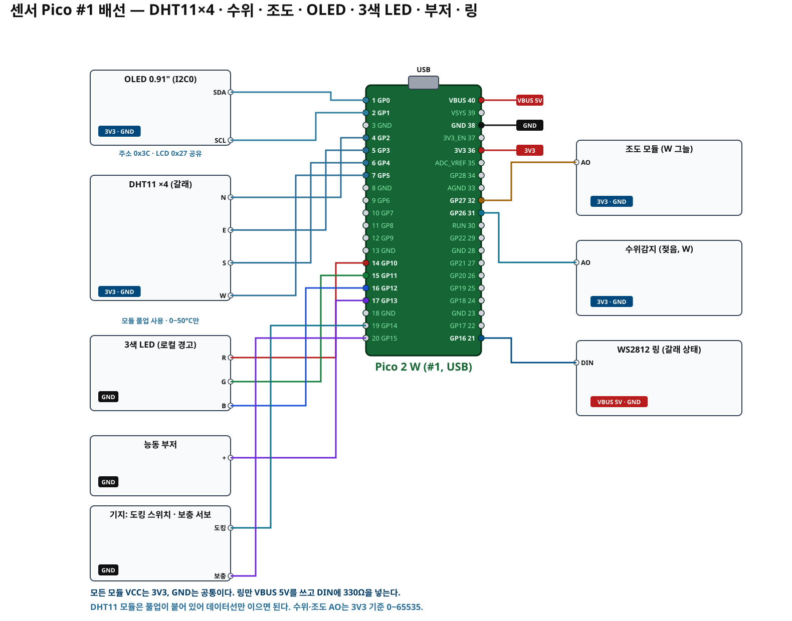
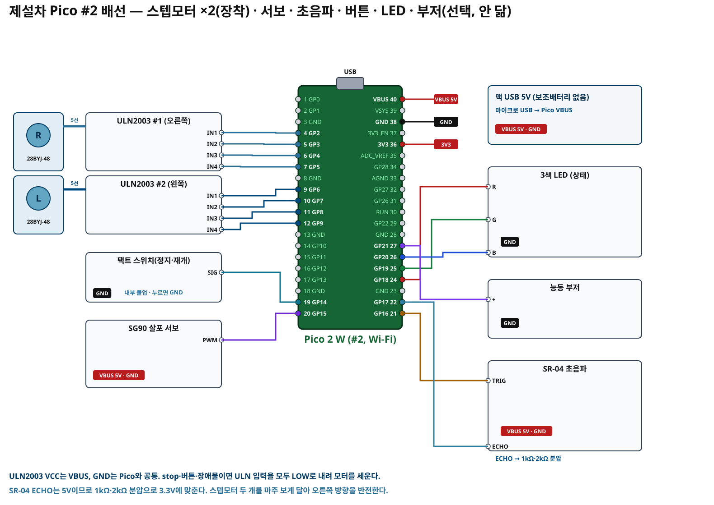
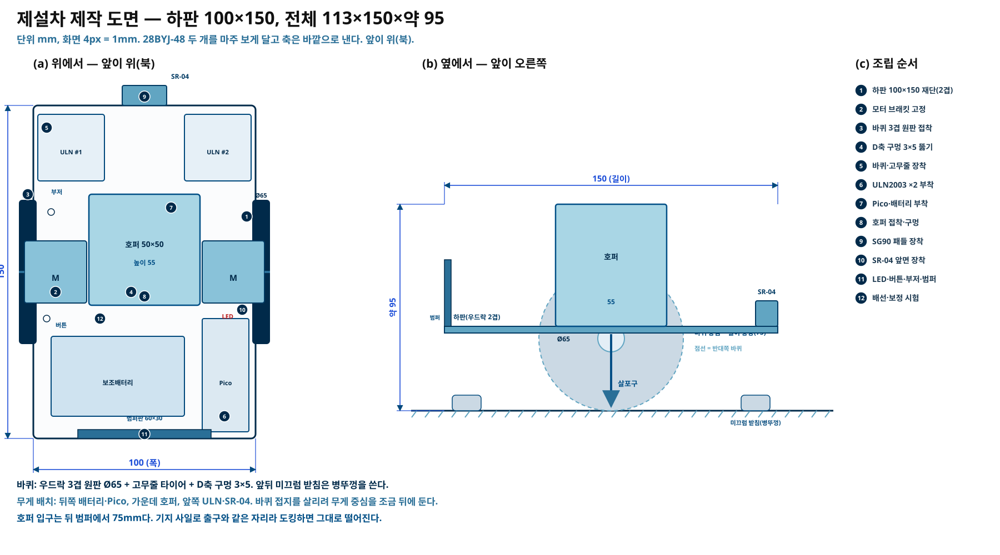

# 제작 안내 — 고색고 ICE-ZERO 자동 제설 모형

핀·상수는 `CONTRACT.md` 6~8절, 설계 이유는 `docs/SYSTEM_DESIGN.md`를 본다.
이 문서는 **무엇을 어떤 순서로 만들고 무엇으로 시험하는가**만 다룬다.



## 1. 부품표

### 1.1 키트에서 가져오는 것 (키트 4개, 품목당 키트마다 1개)

번호는 키트 품목 순서다.

| # | 품목 | 쓰는 곳 | 수량 |
|---|---|---|---|
| 1 | Pico 2 WH | 센서 Pico #1, 제설차 Pico #2 | 2 |
| 2 | SR-04 초음파 | 제설차 앞 장애물 감지 | 1 |
| 5 | DHT11 온습도 | 갈래 기둥 N·E·S·W | 4 |
| 6 | 대형 브레드보드 | 센서 Pico 결선 | 1 |
| 7 | USB 케이블 · A to C 젠더 | 맥북 ↔ 센서 Pico | 1 |
| 8 | 점퍼 FF/MF/MM | 전체 결선 | 넉넉히 |
| 9 | 3색 LED 모듈 | 차 상태, 센서 로컬 경고 | 2 |
| 10 | 5V 스텝모터 28BYJ-48 + ULN2003 | 제설차 좌우 바퀴 | 2 |
| 11 | SG-90 서보 | 호퍼 살포 문 | 1 |
| 12 | 3V 능동 부저 | 센서 경고, 차 상태음 | 2 |
| 13 | 택트 스위치 | 차 비상 정지·재개 | 1 |
| 14 | 수위감지 센서 | W 갈래 젖음 | 1 |
| 15 | 조도 센서 | W 갈래 그늘 | 1 |
| 17 | 0.91" OLED (SSD1306) | 센서 상태 표시 | 1 |
| 21 | 네오픽셀 WS2812 링 | 갈래 상태(선택) | 1 |

키트에 없는 16(가속도), 18(GPS), 19(가변저항), 20(RC522), 22(릴레이), 23(사운드), 24(키패드), 3(LCD), 4(PIR)는 이 모형에서 쓰지 않는다.

### 1.2 추가 조달

| 품목 | 규격 | 수량 | 비고 |
|---|---|---|---|
| 보조배터리 | 5V 2A USB 출력 | 1 | 차 전원. 스텝모터 2개+서보를 넣을 수 있어야 한다 |
| 우드락 원판 | Ø65, 3겹 × 2 | 바퀴 |
| 고무줄 | 넓은 것 | 2 | 바퀴 타이어 |
| 병뚜껑 | — | 2 | 앞뒤 미끄럼 받침 |
| 하판 | 우드락 2겹 또는 아크릴 100×150 | 1 | 차체 |
| 기지 재료 | 우드락 5mm 320×230, 종이컵/PET 원뿔 | 1set | 차고·사일로 |
| SG90 서보 | 보충 게이트용 | 1 | 차 서보와 별도(키트 2대분 사용) |
| I2C 1602 LCD | 0x27 | 1 | 기지 전광판(선택) |
| 저항 | 1kΩ, 2kΩ (1/4W) | 각 2 | SR-04 ECHO 분압 |
| 저항 | 330Ω | 1 | WS2812 DIN 보호(선택) |
| 우드락 | 5mm, 판 크기(사진 기준 약 970×1000) | 1set | 사거리 보드. 이어 붙일 때는 이음선을 밑에서 테이프로 |
| 마른 모래 또는 스티로폼 알갱이 | 한 컵 | 1 | 살포물. 실제 제설제 금지 |
| DS18B20 방수 프로브 | 선택 | 1~2 | 영하 실외 측정용(DHT11은 0~50°C만) |

공구: 커터·자·각도기·글루건·절연테이프·니퍼·드라이버.

## 2. 제작 순서

### 2.1 보드(사거리)

1. 우드락 판을 책상에 놓고 사진 기준 배치를 연필로 옅게 그린다(도로 폭 150, A3 광장).
2. 검은 종이를 폭 150으로 잘라 세로 도로를 판 위 끝까지, 가로 도로를 좌우 끝까지 붙인다.
3. 가운데에 검은 A3 한 장(297 동서 × 420 남북)을 붙여 광장을 만든다.
4. S 도로는 중심에서 395 남쪽에서 끝낸다. 그 아래 흰 공간이 기지 자리다.
5. 센서 기둥 자리를 표시한다(중심 기준): N (+105,−220) · E (+220,+105) · S (−105,+260) · W (−220,−105).
6. 젖음·조도 센서 자리(W 갈래, −300,−95)를 표시한다.
7. 건물 네 곳을 `BASE_AND_CAR.md` 2절 원칙(도로 30·광장 40 이상)대로 세운다. 배치는 `img/board_v2.svg`와 맞춘다.
8. 줄자로 잰 값을 `pico/car/config.py`와 `server/board.json`에 넣는다(`BASE_AND_CAR.md` 1절 표).

### 2.2 제설기지와 관제실

기지 구조(320×230, 차고 140×190×120)는 `BASE_AND_CAR.md` 3절과 `img/base_plan.svg`를 따른다.

1. 기지를 조립한다: 바닥 → 차고 옆벽 → 뒤벽 → 범퍼판·도킹 스위치 → 안내 레일 → 깔때기 → 지붕·사일로 → 관제실.
2. 관제실 브레드보드에 Pico #1을 꽂고 3V3·GND 레일을 만든다.
3. DHT11 4개를 GP2·GP3·GP4·GP5에, 전원은 3V3·GND에 연결한다(모듈 풀업 사용).
4. 수위 센서 AO → GP26(W 갈래), 조도 AO → GP27. 전원은 3V3.
5. OLED(SDA GP0·SCL GP1·0x3C)와 LCD 1602(I2C 0x27)를 같은 버스에 단다.
6. 도킹 스위치를 GP14–GND에, 보충 서보를 GP15에 단다. 서보는 닫힘 0°, 열림 60°.
7. 3색 LED(R GP10·G GP11·B GP12), 부저(GP13), 링 DIN(GP16, 330Ω)을 단다. 링은 지붕 경광등이다.
8. DHT11 기둥을 20cm 높이로 세우고 갈래마다 하나씩 둔다. 선은 보드 밑 케이블 통로로 관제실에 모은다.
9. 젖음·조도 센서를 W 갈래 길가에 눕힌다.
10. `pico/sensors/config.py`의 `WARN_T`를 실내 시연이면 3.0, 실제 설치면 1.0으로 둔다.



### 2.3 제설차

재단·조립 12단계는 `BASE_AND_CAR.md` 4절과 `img/car_build.svg`를 따른다. 요약:

1. 하판 100×150을 2겹으로 붙인다.
2. 28BYJ-48 두 개를 **마주 보게**, 축이 바깥으로 나가게 붙인다.
3. 바퀴 원판 Ø65 3겹 + 고무줄 타이어. D축 3×5 구멍. 두 바퀴 중심 간격 105.
4. ULN2003 ×2를 앞쪽에 붙이고 IN1~IN4를 GP2~GP5, GP6~GP9에 연결한다. VCC는 VBUS, GND 공통.
5. Pico·배터리는 뒤쪽, 호퍼 50×50×55는 가운데. 살포구는 차체 아래.
6. SG90 패들은 호퍼 바닥 구멍에. 닫힘 0°, 열림 70°.
7. SR-04는 앞면(TRIG GP16, ECHO GP17, 1kΩ·2kΩ 분압).
8. LED(GP18·GP19·GP20)·부저(GP21)·버튼(GP14–GND)·범퍼판 60×30을 뒤쪽에 단다.
9. `pico/car/config.py`에 실측값을 넣는다: `WHEEL_D_MM`, `TRACK_MM`, `CENTER_X`, `CENTER_Y`, `BASE_DIST_MM`, `ARM_OUT_MM`, `SPRAY_WIN`, `SERVER_IP`, Wi-Fi(빈 문자열로 두고 업로드할 때만 채운다).





## 3. 시험 T1~T12

각 시험은 **한 가지씩** 확인한다. 실패하면 다음으로 넘어가지 않는다.

| 시험 | 준비 | 하는 일 | 통과 기준 |
|---|---|---|---|
| T1 | 기지 Pico를 맥에 USB 연결 | 시리얼을 열고 2초 기다린다 | `@@TEL`이 2초마다, `dock`·`refills` 포함 |
| T2 | DHT11 4개 | 손으로 갈래 센서를 만진다 | 해당 갈래 `t`가 오르고 `ok`가 true |
| T3 | 수위(W)·조도 | 물방울, 손으로 가림 | `wet`이 true, `light_raw`가 내려간다 |
| T4 | OLED·LCD·LED·부저·링 | `@@SHOW`로 `risk3`, `beacon:true` | 문구·색·경광등이 바뀐다 |
| T5 | 도킹 스위치·보충 게이트 | 손으로 스위치를 누르고 `@@REFILL` | `dock` true, 게이트가 800ms 열린다 |
| T6 | 서버 실행 | `python3 server/gosaek_server.py --sensors-serial auto` | 대시보드에 센서 값이 뜬다 |
| T7 | 모델 학습 완료 | `python3 -m model.icezero.train --stn 119` 뒤 엔진 `step()` | `arms`·`dispatch`가 3자리 소수로 나온다 |
| T8 | 서버 실행 | `/api/state`, `/api/replay/step`, `/monitor` | 200과 JSON, 화면 갱신 |
| T9 | 차 전원 ON | 서버 로그 확인 | `hello` 뒤 `tel`이 500ms마다 온다 |
| T10 | 바닥 1m 줄 | 북향으로 1m 직진 | 오차 1cm 안쪽 |
| T11 | 바닥 기준선 | 제자리 360° 회전 | 5° 안쪽 |
| T12 | 계획 1개 | `plan ["N"]` 전송 | 출발→회전→전진→살포→복귀→후진 도킹, `plan_done` |

추가 확인(배포 전):
- 도킹 1초 뒤 자동 보충(게이트 800ms), `refills`가 1 늘고 다시 열지 않는다.
- 대시보드 `stop` → 차가 즉시 멈추고 자동이 꺼진다.
- 차 버튼 → 즉시 정지, 다시 누르면 남은 구간 재개.
- 차 앞 8cm에 손 → 정지, 1초 뒤 비키면 재개. **후진 중에는 무시**한다.

## 4. 모니터에 띄우기

모형 옆에 모니터를 두고, 대시보드 대신 `/monitor` 화면을 전체 화면으로 띄운다.

1. 맥과 모니터를 연결하고, 서버를 켠다.
   ```
   python3 server/gosaek_server.py --stn 119 --mode replay --auto
   ```
2. 맥 IP를 확인한다.
   ```
   ipconfig getifaddr en0
   ```
3. 같은 Wi-Fi의 다른 기기(태블릿·노트북)에서는 `http://<맥 IP>:8000/monitor`를 연다.
4. 맥에서 직접 띄울 때는 키오스크 모드로 연다.
   ```
   open -a "Google Chrome" --args --kiosk http://localhost:8000/monitor
   ```
5. 외부 모니터로 옮길 때: 창을 모니터로 끌어 옮긴 뒤 `⌃⌘F`(전체 화면)를 누른다.
6. 3m 거리에서 갈래 확률과 상태가 읽히는지 확인한다. 안 읽히면 브라우저 확대를 125%로 올린다.

`/monitor`는 조작 버튼이 없고 1초마다 갱신된다. 조작은 다른 기기에서 `/`로 한다.

## 5. 90초 자동 시연 대본

| 시각 | 하는 일 | 보여 주는 것 |
|---|---|---|
| 0~10s | 서버·모니터를 켠 상태에서 시작 | 모니터에 사거리·갈래 확률이 이미 떠 있다 |
| 10~25s | 재생 시각을 밤으로 넘긴다(`/api/replay/step {"hours":2}`) | 예측 동결확률이 오르고 `risk3` 갈래가 생긴다 |
| 25~35s | 센서 기둥에 얼음팩을 대거나 손으로 식힌다 | 현장 보정 `dt`가 내려가고 확률이 더 오른다 |
| 35~45s | 자동 출동이 켜져 있음을 말로 확인 | `recommend:true`, `plan` 전송, 기지 경광등(`beacon`)이 돈다 |
| 45~65s | 차가 기지에서 출발 → 갈래 회전·전진·살포 | 모니터에서 `phase`(depart→turn→out)와 `spray:true`가 움직인다 |
| 65~78s | 복귀 후 북향 **후진**으로 차고에 들어간다 | `phase:home`, `dock:true` |
| 78~85s | 자동 보충: 사일로 게이트가 800ms 열린다 | `refills`가 1 늘고 게이트가 닫힌다 |
| 85~90s | 대시보드 `stop`을 누른다 | 차가 즉시 서고 자동이 꺼진다. 안전 설명으로 마무리 |

말할 때 쓰는 표현: "예측 동결확률", "상대 우선순위". **"결빙 확정"이라고 말하지 않는다.**

## 6. 문제 해결

| 증상 | 원인 후보 | 조치 |
|---|---|---|
| `@@TEL`이 안 온다 | USB 케이블이 전원 전용, 시리얼 포트 이름 다름 | 데이터 케이블로 바꾸고 `ls /dev/tty.usbmodem*` 확인, `--sensors-serial`에 직접 지정 |
| DHT11 값이 null | 결선 접촉 불량, 2초 간격 미준수 | 점퍼를 다시 꽂고, 전원 인가 후 2초 기다린다. 영하 환경이면 DS18B20으로 바꾼다 |
| 젖음 판정이 반대로 된다 | 모듈 극성 | `WET_WHEN_LOW`를 뒤집고 `WET_THRESHOLD`를 다시 잡는다 |
| 차가 한쪽으로 돈다 | 두 모터 장착 방향, 오른쪽 반전 누락 | config에서 오른쪽 방향 반전을 확인, `TRACK_MM` 재측정 |
| 차가 1m를 못 간다 | 바퀴 지름·스텝 설정 | T10으로 실측 보정(`STEPS_PER_REV = 현재값 × 1000/d`) |
| 도킹 스위치가 안 눌린다 | 후진 거리 부족, 범퍼판 위치 | `DOCK_OVERDRIVE_MM`을 5씩 올린다(최대 25) |
| 도킹했는데 보충을 안 한다 | 1초 유지 전에 흔들림, 쿨다운 20초 | 차를 세우고 `dock`이 1초 이상 true인지 확인 |
| 사일로가 안 떨어진다 | 알갱이 막힘, 출구 Ø12 | 젓가락으로 풀고, 알갱이를 마른 것으로 바꾼다 |
| 차가 재부팅한다 | 모터 기동 전류로 전압 강하 | 보조배터리 충전, `STEP_US`를 1500으로 올려 속도 낮춤 |
| UDP `tel`이 끊긴다 | 같은 Wi-Fi가 아님, IP 변경 | `SERVER_IP` 고정, 공유기에서 맥 IP 예약 |
| `plan`이 거절된다(ok=false) | 이미 계획 실행 중 | `stop` 뒤 다시 보낸다 |
| 모니터가 하얗다 | `/monitor` 대신 `/` | 주소 확인, 서버 로그의 안내 주소 사용 |
| 초음파가 계속 장애물이라 한다 | 분압 없음, 반사면 | 1k·2k 분압 확인, 센서를 살짝 위로 든다 |

## 7. 시연 전 체크리스트

- [ ] 보조배터리 충전(2칸 이상), USB 케이블 2개
- [ ] 서버·모니터가 같은 네트워크
- [ ] 센서 기준값 다시 잡기(`/api/sensors/baseline`)
- [ ] 차 도킹 위치·북향 정렬
- [ ] 호퍼와 사일로에 마른 모래 한 컵
- [ ] 도킹 스위치 `dock` true, 자동 보충 1회 확인
- [ ] 비상 정지 세 갈래(대시보드·버튼·초음파) 동작 확인
- [ ] 대시보드 문구가 '예측 동결확률'인지 확인
