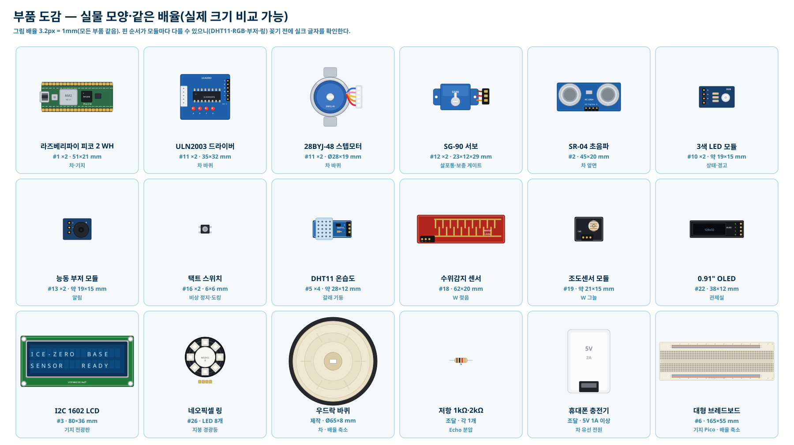
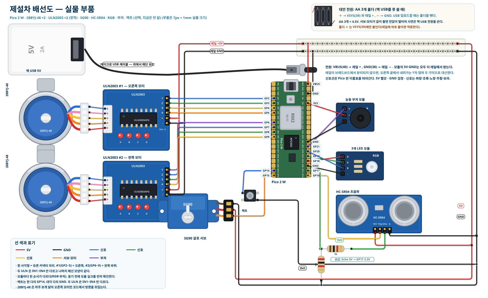
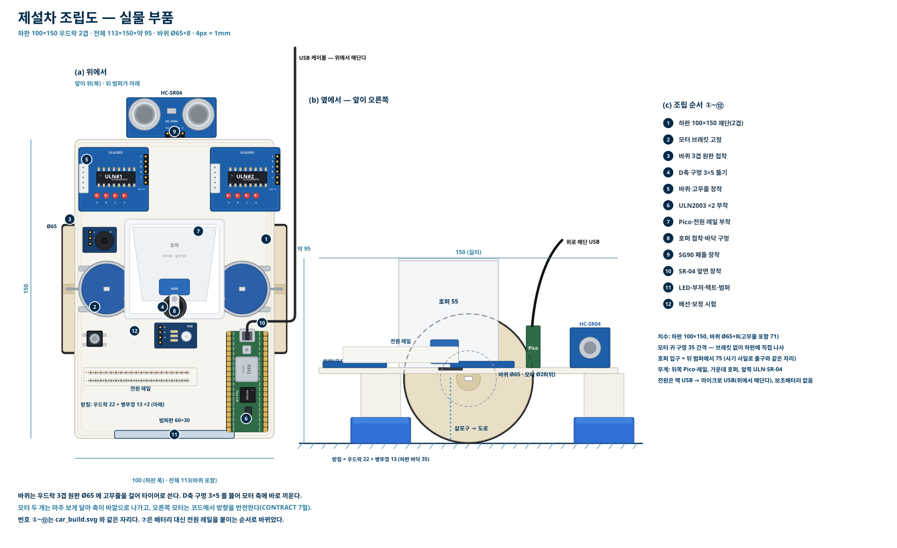
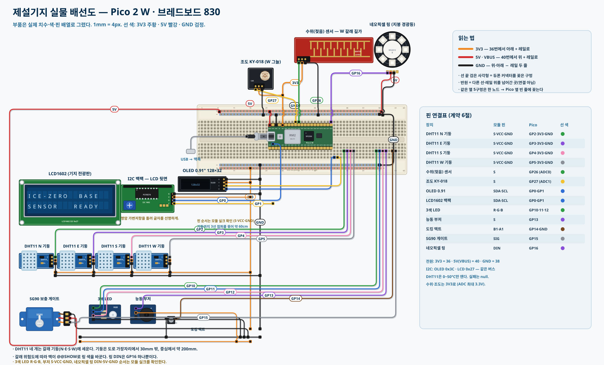
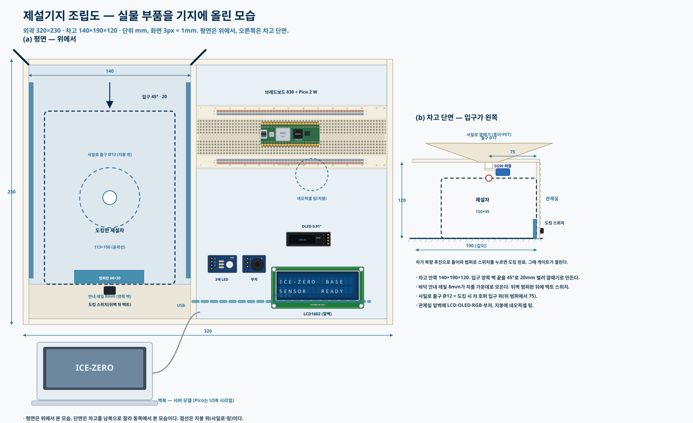

# 실물 부품 배선도·조립도

키트 부품을 실제 모양·치수·색으로 그린 배선도와 조립도다. 핀·상수의 기준은 `CONTRACT.md` 6·7·9절이다.

지금 제설차에는 28BYJ-48 두 개와 ULN2003 두 장만 달았다. 서보·초음파·3색 LED·부저·택트는 핀만 정해 둔 선택 부품이다. 차 전원은 맥 USB다(보조배터리·충전기 없음).

## 1. 부품 도감

| 부품 | 키트 번호 | 수량 | 실제 크기(mm) | 쓰는 곳 |
|---|---|---|---|---|
| 라즈베리파이 피코 2 WH | #1 | 2 | 51×21 | 제설차 Pico #2, 기지 Pico #1 |
| 28BYJ-48 스텝모터 + ULN2003 드라이버 | #11 | 2세트 | 모터 Ø28×19, 보드 35×32 | 제설차 바퀴 |
| SG-90 서보 | #12 | 2 | 23×12×29 | 차 살포통, 기지 보충 게이트 |
| SR-04 초음파 | #2 | 1 | 45×20 | 차 앞면 장애물 정지 |
| 3색 LED 모듈 | #10 | 2 | 약 19×15 | 차 상태, 기지 경고 |
| 3V 능동 부저 모듈 | #13 | 2 | 약 19×15 | 차·기지 알림 |
| 택트 스위치 | #16 | 2 | 6×6 | 차 비상 정지, 기지 도킹 감지 |
| DHT11 온습도 모듈 | #5 | 4(키트 4개) | 약 28×12 | 갈래 길가 기둥 |
| 수위감지 센서 | #18 | 1 | 62×20 | W 갈래 젖음 |
| 조도센서 모듈 | #19 | 1 | 약 21×15 | W 갈래 그늘 밝기 |
| 0.91" OLED | #22 | 1 | 38×12 | 기지 관제실 |
| I2C 1602 LCD | #3 | 1 | 80×36 | 기지 전광판 |
| 네오픽셀 WS2812 링 | #26 | 1 | 링 | 기지 지붕 경광등 |
| 대형 브레드보드 | #6 | 1(+레일 한 줄) | 165×55 | 기지 Pico, 차 5V/GND 레일 |
| 점퍼 FF/MF/MM | #9 | - | 20cm | 모든 연결 |
| 저항 1kΩ·2kΩ | 조달 | 각 1 | - | SR-04 Echo 분압 |
| 마이크로 USB 데이터 케이블 | 조달/키트 #7 | 1 | - | 차 전원(맥 USB) |

- DHT11·RGB LED·부저·네오픽셀은 제조사마다 핀 순서가 다르다. 꽂기 전에 모듈 실크 글자를 확인한다.

## 2. 제설차 실물 배선도

| 장치 | 장치 핀 | Pico 핀(물리 번호) | 선 색 |
|---|---|---|---|
| 맥 USB → 마이크로 USB | - | USB 단자(유선, 위에서 매닮) | - |
| 전원 레일 | + / − | VBUS(40) / GND(38) | 빨강 / 검정 |
| ULN2003 #1(오른쪽 바퀴) | IN1~IN4 | GP2(4)·GP3(5)·GP4(6)·GP5(7) | 파랑·초록·노랑·주황 |
| ULN2003 #2(왼쪽 바퀴) | IN1~IN4 | GP6(9)·GP7(10)·GP8(11)·GP9(12) | 보라·파랑·초록·노랑 |
| ULN2003 #1·#2 | + / − | 레일 + / − | 빨강 / 검정 |
| 28BYJ-48 ×2 | 흰 5핀 커넥터 | 각 ULN 보드 소켓 | 모터 선(파랑·분홍·노랑·주황·빨강) |
| SG90 살포 서보(선택) | SIG(주황) / 5V(빨강) / GND(갈색) | GP15(20) / 레일 + / 레일 − | 주황 / 빨강 / 검정 |
| HC-SR04(선택) | Trig / Echo | GP16(21) / 1kΩ 거쳐 GP17(22), GP17 노드 → 2kΩ → GND | 노랑 / 초록 |
| HC-SR04(선택) | VCC / Gnd | 레일 + / − | 빨강 / 검정 |
| 3색 LED(선택) | R / G / B / GND | GP18(24) / GP19(25) / GP20(26) / GND(23) | 빨강 / 초록 / 파랑 / 검정 |
| 능동 부저(선택) | S / VCC / GND | GP21(27) / 3V3(36) / GND(28) | 보라 / 빨강 / 검정 |
| 택트 스위치(비상 정지, 선택) | 한 다리 / 대각 다리 | GP14(19) / 레일 − | 파랑 / 검정 |

- 2026-11-01 수리로 범퍼가 반대쪽 끝으로 가서, 예전 왼쪽 바퀴 보드(#1, GP2~5)가 지금 오른쪽 바퀴다. 오른쪽 모터만 코드에서 방향을 뒤집는다(`RIGHT_INVERT=True`).

- 대안 전원: AA 3개 홀더 + → VSYS(39)·레일 +, − → GND. USB로 코드를 올릴 때는 홀더를 뺀다.
- 레일이 브레드보드에서 분리되지 않는 제품이면, 레일 대신 Y자 점퍼로 5V·GND를 나눈다.

## 3. 제설차 실물 조립도

- 조립 번호 ①~⑫는 `BASE_AND_CAR.md` 4절의 순서와 같다.
- 전원 케이블(맥 USB)은 위로 걸어 늘어뜨린다. 도로와 바퀴에 끌리지 않게 한다.
- 조립도는 첫 설계 차(하판 100×150, Ø65 바퀴, 호퍼)다. 지금 차는 길이 230, 범퍼 폭 152, 병뚜껑 바퀴 지름 30이다(`CONTRACT.md` 9절).

## 4. 기지 실물 배선도

| 장치 | 모듈 핀 | Pico 핀(물리 번호) | 선 색 |
|---|---|---|---|
| 맥북 USB | - | USB 단자 | - |
| 브레드보드 레일 | 3V3 / 5V / GND | 3V3(36) → 아래 + 레일, VBUS(40) → 위 + 레일, GND(38) → − 레일 | 주황 / 빨강 / 검정 |
| DHT11 N·E·S·W 기둥 | S | GP2(4)·GP3(5)·GP4(6)·GP5(7) | 초록·보라·분홍·회색 |
| DHT11 ×4 | VCC / GND | 3V3 / GND | 주황 / 검정 |
| 수위(젖음) 센서 | S / VCC / GND | GP26(31) / 3V3 / GND | 초록 |
| 조도 KY-018 | S / VCC / GND | GP27(32) / 3V3 / GND | 노랑 |
| OLED 0.91" (0x3C) | SDA / SCL / VCC / GND | GP0(1) / GP1(2) / 3V3 / GND | 파랑 / 노랑 |
| LCD1602 I2C 백팩 (0x27) | SDA / SCL / VCC / GND | GP0 / GP1(OLED와 같은 버스) / 3V3 / GND | 파랑 / 노랑 |
| 3색 LED | R / G / B | GP10(14) / GP11(15) / GP12(16) | 초록 / 파랑 / 분홍 |
| 능동 부저 | S | GP13(17) | 보라 |
| 도킹 택트 스위치 | 한 다리 / 대각 다리 | GP14(19) / GND | 갈색 / 검정 |
| 보충 게이트 SG90 | SIG / 5V / GND | GP15(20) / VBUS 레일 / GND | 회색 / 빨강 / 검정 |
| 네오픽셀 링 | DIN / 5V / GND | GP16(21) / VBUS 레일 / GND | 보라 / 빨강 / 검정 |

- 수위·조도 센서 VCC는 3V3에 연결한다. ADC 입력이 3.3V를 넘지 않게 하기 위해서다.
- LCD 글자가 흐리면 백팩의 파란 가변저항(명암)을 돌린다.

## 5. 기지 실물 조립도

- 도킹 스위치는 뒤벽 범퍼판 뒤에 단다. 차가 후진해 범퍼판을 밀면 눌린다.
- 보충 게이트 SG90은 사일로 깔때기 출구 바로 아래에 둔다. 출구는 도킹한 차의 호퍼 입구 위다(뒤에서 75mm).
