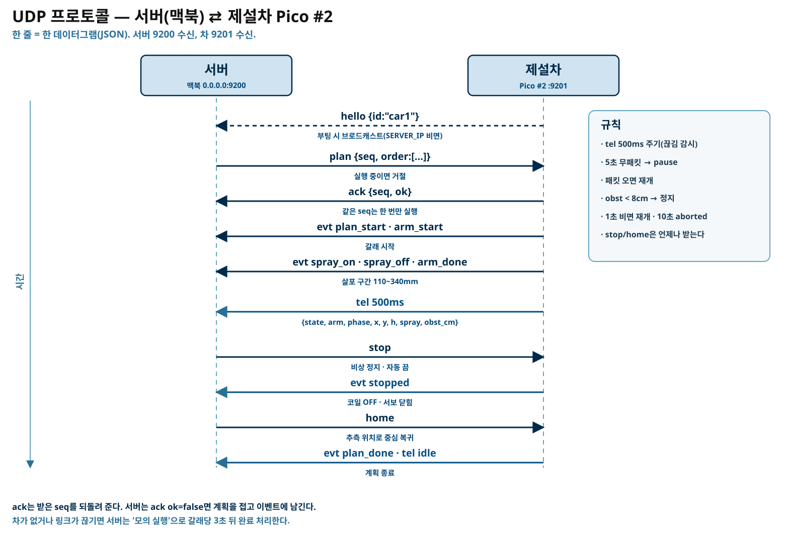
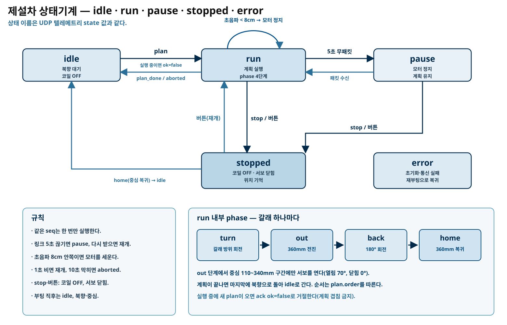
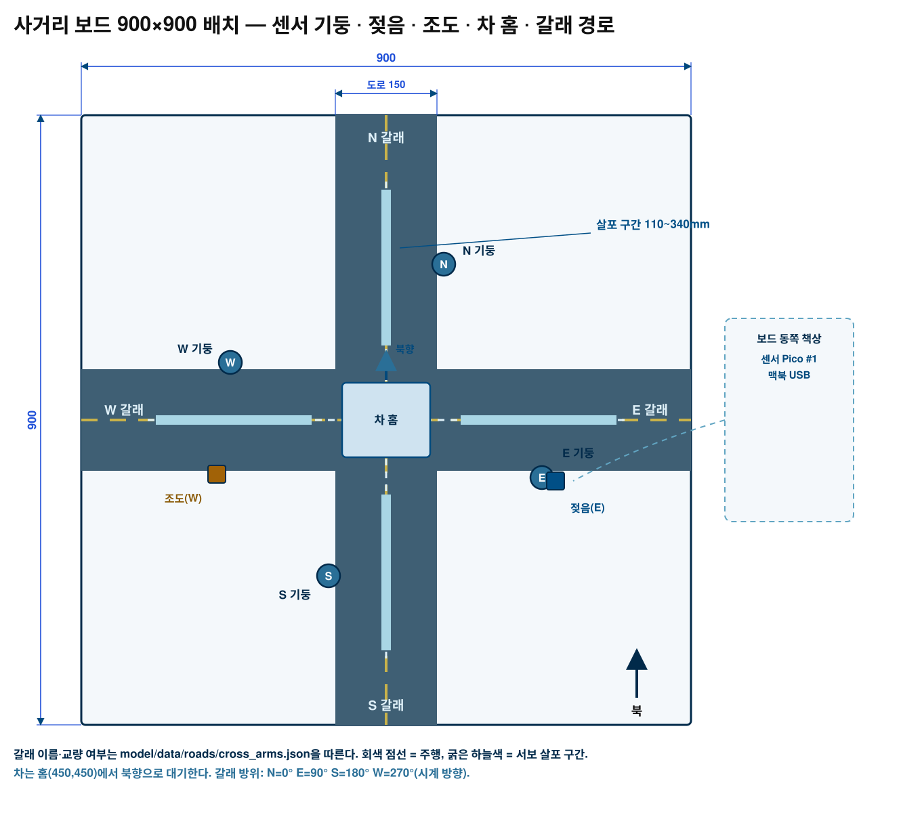

# 시스템 설계 — 고색고 ICE-ZERO 자동 제설 모형

기준은 `CONTRACT.md`다. 여기 적힌 핀·상수는 계약 6~8절과 같다. 그림은 같은 폴더의 `img/*.svg`다.

## 1. 구성

| 부분 | 하는 일 | 실행 위치 |
|---|---|---|
| 모델·엔진 | 수원 ASOS(지점 119)로 다시 학습한 지면온도 예보, 갈래별 예측 동결확률·우선순위 | 맥북 `model/icezero/` |
| 서버·대시보드 | 상태 API, 센서 융합, 자동 출동 판단, 이벤트 기록 | 맥북 `server/gosaek_server.py` |
| 센서 Pico #1 | 갈래 온습도·젖음·조도 측정, OLED·LED·부저로 현장 표시 | `pico/sensors/` |
| 제설차 Pico #2 | 스텝모터 주행, 서보 살포, 초음파 정지, UDP 통신 | `pico/car/` |
| 사거리 보드 | 900×900 우드락 사거리, 센서 기둥, 차 홈 | 책상 |

- 맥북은 모델을 돌리고 판단한다. **LLM은 쓰지 않는다.** 화면 문구도 '예측 동결확률', '상대 우선순위'다.
- Pico 두 대는 서로 직접 말하지 않는다. 모두 맥북을 거친다(센서는 USB, 차는 Wi-Fi UDP).
- 모니터는 같은 서버의 `/monitor`를 전체 화면으로 띄운다(계약 5절).

## 2. 데이터 흐름

1. **학습(한 번)**: `data/raw/119/` ASOS 원본 → 피처 → XGBoost 회귀·분류 → `model/models/119/*.json`.
2. **도로(한 번)**: Overpass로 고색고 반경 1.5km 도로·교량·건물 → `data/roads/cross_arms.json`.
3. **실행(매 순간)**: 서버가 1초마다 엔진 `step()`을 부른다.
   - 엔진은 그 시각의 예보와 갈래 속성으로 `p_freeze`·`level`·`priority`를 낸다.
   - 서버는 센서 Pico의 `@@TEL`을 받아 갈래 `dt`(현장 온도차)와 E 갈래 젖음을 `local`로 넣는다.
   - `recommend`가 참이고 차가 idle이면 `plan`을 보낸다.
4. **표시**: 서버가 `@@SHOW`로 센서 Pico의 링·OLED에 갈래 상태를 보내고, 대시보드·모니터에 같은 내용을 그린다.
5. **복귀**: 차가 `arm_done`을 보내면 서버가 그 갈래를 3시간 동안 처리됨(`done`)으로 둔다.

## 3. Pico 두 대의 역할

### 센서 Pico #1 (USB 시리얼)

- DHT11 4개로 갈래별 온·습도를 재고, 수위 센서로 E 갈래 젖음을, 조도 센서로 W 그늘 밝기를 읽는다.
- 2초마다 `@@TEL` 한 줄을 보낸다.
- 맥이 죽어도 로컬 경고는 계속 돈다: 어느 갈래든 `t ≤ WARN_T`이고 `rh ≥ WARN_RH`이거나, 젖었고 `t ≤ WARN_T`면 3색 LED·부저를 켠다. 3회 연속 거짓이면 끈다.
- DHT11은 0~50°C만 잰다. 영하 실외에서는 값이 없거나 0에 붙으므로, 야외 설치 때는 DS18B20 같은 다른 센서가 필요하다(계약 밖 선택 품목).

### 제설차 Pico #2 (Wi-Fi UDP)

- `plan`을 받으면 갈래 순서대로 ① 방위 회전 ② 360mm 전진(중심 110~340mm에서만 서보 열기) ③ 180° 회전 ④ 중심 복귀를 한다.
- 500ms마다 `tel`로 상태·위치·진행 단계를 보낸다.
- 명령 `stop`·`home`과 차 버튼, 초음파 장애물 정지는 항상 우선한다.

## 4. 핀표

### 4.1 센서 Pico #1 — `pico/sensors/config.py`

| 장치 | 핀 | 계약 |
|---|---|---|
| DHT11 N / E / S / W | GP2 / GP3 / GP4 / GP5 | 6절 |
| 수위감지 AO(젖음, E) | GP26 (ADC0) | 6절 |
| 조도 AO(W 그늘) | GP27 (ADC1) | 6절 |
| OLED SSD1306 128×32 I2C0 | SDA GP0, SCL GP1, 0x3C | 6절 |
| 3색 LED | R GP10, G GP11, B GP12 | 6절 |
| 능동 부저 | GP13 | 6절 |
| WS2812 링 DIN | GP16 | 6절 |

### 4.2 제설차 Pico #2 — `pico/car/config.py`

| 장치 | 핀 | 계약 |
|---|---|---|
| 왼쪽 28BYJ-48 (ULN2003 IN1~IN4) | GP2, GP3, GP4, GP5 | 7절 |
| 오른쪽 28BYJ-48 (ULN2003 IN1~IN4) | GP6, GP7, GP8, GP9 | 7절 |
| SG90 살포 서보 | GP15 (닫힘 0°, 열림 70°) | 7절 |
| SR-04 TRIG / ECHO | GP16 / GP17 | 7절 |
| 택트 스위치(정지·재개, 풀업) | GP14 | 7절 |
| 3색 LED | R GP18, G GP19, B GP20 | 7절 |
| 능동 부저 | GP21 | 7절 |

기구 상수: `WHEEL_D_MM=65`, `TRACK_MM=105`, `STEPS_PER_REV=4096`(하프스텝), `STEP_US=1200`.
두 모터를 마주 보게 달기 때문에 오른쪽 모터 방향을 소프트웨어에서 반전한다.

## 5. 전원

| 부하 | 전압 | 전류(대략) | 전원 |
|---|---|---|---|
| Pico #2 자체 | 5V→3.3V | 60~120mA | 보조배터리 USB |
| 28BYJ-48 두 개 | 5V (ULN2003 VCC=VBUS) | 코일 2상 × 2대 ≈ 400~600mA | 보조배터리 |
| SG90 서보 | 5V | 100~250mA(이동 순간) | 보조배터리 |
| SR-04 | 5V | 15mA | 보조배터리 |
| WS2812 링(센서 쪽) | 5V (VBUS) | 밝기 48에서 최대 100mA | 맥북 USB |

- 5V 2A 보조배터리면 위 합(순간 1A 안팎)을 넣기 충분하다. 스텝모터를 돌릴 때 서보를 동시에 움직이지 않는다(펌웨어가 순서를 지킨다).
- ULN2003 VCC는 **VBUS**, GND는 Pico와 공통으로 묶는다. 모터 전원을 Pico 3V3에서 끌어오지 않는다.
- 맥북 USB는 센서 Pico #1에만 쓴다. 센서 Pico는 5V 부하가 링 하나뿐이라 USB 전류로 충분하다.
- 서보·모터를 한꺼번에 움직이면 전압이 떨어져 Pico가 재부팅할 수 있다. 그래서 `STEPS_PER_REV`·`STEP_US`를 크게 잡아 속도를 낮춘다.
- SR-04 ECHO는 5V 출력이다. 1kΩ·2kΩ 분압으로 3.3V에 맞춘다(계약 권장).

## 6. 프로토콜

### 6.1 맥 ↔ 센서 Pico (USB 시리얼, 115200, 한 줄 = 한 메시지)

- Pico → 맥, 2초마다: `@@TEL {"t":{"N":1.2,...},"rh":{...},"ok":{...},"wet_raw":40000,"wet":false,"light_raw":21000,"warn":false,"up":12345}`
- 맥 → Pico: `@@SHOW {"arms":{"N":"risk1","E":"risk3"},"msg":"동쪽 먼저"}` — `msg`는 16자 이내.

### 6.2 맥 ↔ 제설차 (Wi-Fi UDP, 서버 9200 수신, 차 9201 수신)

| 방향 | 메시지 |
|---|---|
| 차 → 서버 | `hello {id}`(부팅, `SERVER_IP`가 비면 브로드캐스트) |
| 서버 → 차 | `plan {seq, order}` / `stop` / `home` / `ping` |
| 차 → 서버 | `ack {seq, ok, reason}` |
| 차 → 서버 | `evt {e, seq, arm}` — `plan_start`·`arm_start`·`spray_on`·`spray_off`·`arm_done`·`plan_done`·`stopped`·`obstacle`·`resumed`·`aborted` |
| 차 → 서버 | `tel` 500ms — `state`, `arm`, `phase`, `x`, `y`, `h`, `spray`, `obst_cm`, `up` |

- 같은 `seq`는 한 번만 실행한다(재전송 대비).
- `LINK_TIMEOUT_MS=5000` 넘게 서버 패킷이 없으면 `pause`, 다시 받으면 `resume`.

## 7. 상태기계

- `idle` → `plan` → `run`(turn → out → back → home) → `plan_done` → `idle`.
- `run` 중 5초 무패킷이면 `pause`, 패킷이 오면 `run`으로 돌아간다.
- `stop`·버튼·장애물 → 모터 코일 OFF, 서보 닫힘. 버튼을 다시 누르면 재개한다.
- `home`을 받으면 추측 위치로 중심에 돌아가 북향으로 선다.
- 초음파 8cm 안쪽이면 모터를 세우고, 1초 비면 재개, 10초 넘게 막히면 `aborted`를 보낸다.

## 8. 안전

- 자동 출동에도 **비상 정지 세 갈래**가 항상 살아 있다: 대시보드 `stop`, 차 버튼, 초음파 장애물 정지.
- `stop`은 자동 모드를 끈다. 다시 켜야 자동 출동이 재개된다.
- 차가 없거나 링크가 끊기면 서버는 모의 실행(갈래당 3초)으로 표시만 한다. 실제 살포로 오해하지 않도록 대시보드에 표시한다.
- 결빙을 '확정'했다고 쓰지 않는다. 화면·로그 모두 '예측 동결확률', '상대 우선순위'다.
- 모형의 살포물은 마른 모래·스티로폼 알갱이다. 실제 제설제를 쓰지 않는다(전자부·우드락 손상).

## 9. 보정 방법

### 9.1 기구 상수(차)

1. 바퀴 지름을 캘리퍼로 잰다(예: 65.3mm). `WHEEL_D_MM`에 넣는다.
2. 두 바퀴 중심 사이 거리를 잰다(예: 104mm). `TRACK_MM`에 넣는다.
3. **1m 직진 시험**: 바닥에 1m 줄을 긋고 북향에서 출발시킨다. 실제 이동 거리 `d`를 재서
   `STEPS_PER_REV = 현재값 × 1000 / d` 로 고친다(한 바퀴 스텝은 하프스텝 4096이 기본).
4. **360° 회전 시험**: 바닥에 테이프로 기준선을 긋고 제자리 360° 회전시킨다. 한 바퀴보다 덜 돌면
   `TRACK_MM`을 키우고, 더 돌면 줄인다. 좌우가 어긋나면 오른쪽 모터 스텝 보정값을 조정한다.
5. 두 시험을 번갈아 두 번 하면 1cm 안쪽으로 맞는다.

### 9.2 젖음 센서

1. 마른 채로 `@@TEL`의 `wet_raw`를 읽는다(예: 61000).
2. 물을 묻혀 다시 읽는다(예: 18000).
3. 중간값을 `WET_THRESHOLD`에 넣고, 젖을 때 값이 작아지면 `WET_WHEN_LOW=True`.

### 9.3 현장 온도 보정

- 서버는 시작 30초 평균(또는 `/api/sensors/baseline` 시점)을 갈래 기준값으로 잡는다.
- 이후 `dt = T_k − baseline_k`를 엔진 `local`로 넣는다. 실내 시연에서는 기준값을 다시 잡아야 한다.
- 센서가 10초 넘게 조용하면 서버는 `local`을 비운다(모델만으로 판단).

### 9.4 모델

- 학습·검증 수치와 방법 선택은 `docs/MODEL.md`를 본다.
- 재학습: `python3 -m model.icezero.train --stn 119 --force`.

## 10. 보드 배치

- 보드 900×900, 도로 띠 x 375~525 · y 375~525(폭 150). 갈래는 `cross_arms.json`을 따른다.
- 센서 기둥(DHT11): N (535,220) · E (680,535) · S (365,680) · W (220,365).
- 젖음 센서 (700,540), 조도 센서 (200,530).
- 차 홈 = 중심 (450,450), 북향 대기. 갈래 방위 N=0° E=90° S=180° W=270°(시계 방향).
- 차는 중심에서 360mm 나갔다 돌아온다. 서보는 중심 110~340mm 구간에서만 연다.

- 차체 약 130×110, 바퀴 지름 65, 바퀴 중심 간격 105. 앞쪽 SR-04, 뒤쪽 보조배터리, 가운데 호퍼·서보.
- 28BYJ-48 두 개를 마주 보게 달아 바퀴를 차체 밖으로 내고, 캐스터·슬라이더로 앞뒤를 받친다.
